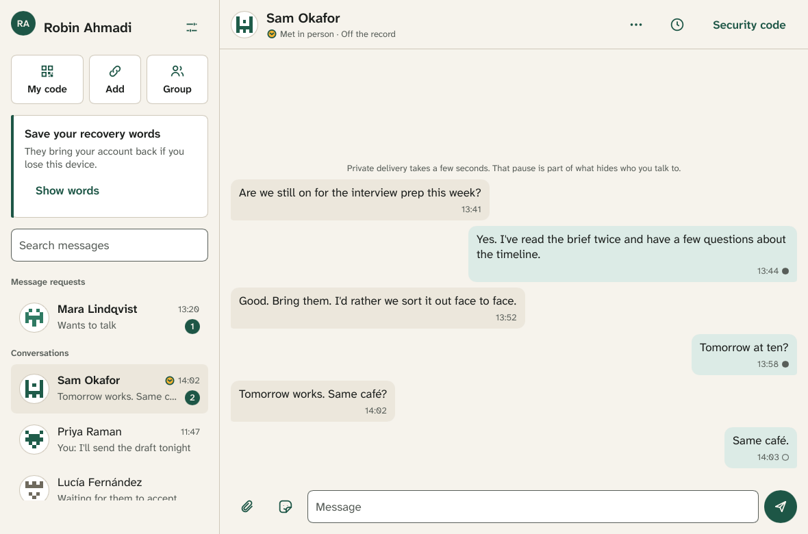

# Enclave

Enclave is an open-source messenger with the features people expect from
Signal (chats, groups, voice and video calls, photos, voice notes, reactions,
disappearing messages) and a much stronger design against surveillance:

* **Post-quantum from the first message.** Every session combines three
  independent key-exchange families (X448, ML-KEM-1024 and Classic
  McEliece-8192128), and every ratchet turn takes a full post-quantum step.
* **Metadata hidden, not just content.** Traffic goes through the Nym mixnet
  over Tor, every message is the same size, and cover traffic hides when you
  are talking. Servers never learn who writes to whom.
* **No phone number, no email.** Your account is a key. Usernames are optional
  and checked by public key-transparency logs with independent witnesses.
* **No trusted server.** Anyone can run one; none of them can read messages,
  see your contacts or change your keys without being caught.
* **Rust everywhere possible**, including the UI.

The full design is in [`docs/PLAN.md`](docs/PLAN.md). Specifications are in
[`docs/`](docs/).

## Status

The protocol, the servers, the network layer (Nym over Tor), the desktop
app and the release pipeline are built and tested in CI; Android and iOS
are being built (`docs/completion.md` tracks every item). Enclave has not
been audited yet: don't rely on it to protect anyone until it has.

## Install

Every release is on the [releases page](https://github.com/EnclaveChat/Enclave/releases/latest).
`VERSION` below is its version (for example `1.2.0`).

### Linux

| Distribution | Install |
|---|---|
| Debian, Ubuntu and derivatives | `sudo apt install ./enclave-messenger_VERSION_amd64.deb` (`arm64` on ARM) |
| Fedora, RHEL, Rocky, Alma, openSUSE | `sudo dnf install ./enclave-messenger-VERSION-1.x86_64.rpm` (`aarch64` on ARM) |
| Arch, Manjaro | `yay -S enclave-messenger-bin` (the release's programs) or `yay -S enclave-messenger` (built from source), from the AUR |
| Any distribution, Flatpak | `flatpak install --user ./Enclave-VERSION-x86_64.flatpak` (`aarch64` on ARM), then `flatpak run io.github.EnclaveChat.Enclave` |
| Any distribution, AppImage | `chmod +x Enclave-VERSION-x86_64.AppImage && ./Enclave-VERSION-x86_64.AppImage` |
| Any distribution, tarball | unpack `enclave-VERSION-x86_64-unknown-linux-gnu.tar.gz` and run `enclave` from that folder (its programs start each other from there) |

The packages need glibc 2.34 or newer (Debian 12, Ubuntu 22.04, Fedora 35,
RHEL 9 and later). To keep your profile's key in the system keyring, have a
Secret Service running (GNOME Keyring, KWallet or KeePassXC); without one the
key is kept in a file in the profile.

### macOS

Open `Enclave-VERSION-macos.dmg` and drag Enclave to Applications. One
build runs on Apple silicon and Intel Macs, macOS 12 or later; it is signed
and notarized, so it opens without warnings. (`Enclave-VERSION-macos.app.zip`
holds the same app.)

### Windows

Run `Enclave-VERSION-x86_64-setup.exe` (installs for you, no administrator
rights needed) or `Enclave-VERSION-x86_64.msi` (installs for every user of
the PC); `aarch64` for Windows on ARM. Windows 10 or later. The installers
aren't signed with a Windows certificate yet, so SmartScreen asks first:
choose "More info", then "Run anyway". `enclave-VERSION-x86_64-pc-windows-msvc.zip`
holds the programs without an installer.

### Android

Install `Enclave-VERSION-android.apk` (or the one for your phone's
processor, `-arm64-v8a` or `-x86_64`): open it on the phone and allow
installing from your browser or file manager when Android asks. Android 9
or later. Google Play and F-Droid listings will follow (`Enclave-VERSION.aab`
is the bundle for Play).

### iOS and iPadOS

Join the TestFlight beta from the link in the release notes until Enclave is
on the App Store. The release's `Enclave-VERSION-ios.ipa` can also be
installed with a sideloading tool such as AltStore or SideStore, which signs
it with your own Apple ID. iOS 16 or later.

### Check what you downloaded

Every file of a release is listed in `SHA256SUMS` and `SHA3-512SUMS`,
whose Sigstore bundles prove they come from this repository's release
workflow:

```sh
cosign verify-blob SHA256SUMS --bundle SHA256SUMS.sigstore.json \
  --certificate-identity-regexp '^https://github.com/EnclaveChat/Enclave/.github/workflows/release.yml@refs/tags/v' \
  --certificate-oidc-issuer https://token.actions.githubusercontent.com
sha256sum --ignore-missing -c SHA256SUMS
gh attestation verify FILE --repo EnclaveChat/Enclave   # build provenance
```

## Run a server

An operator runs one stack: the server (keys, inboxes, the
key-transparency log), a witness that cosigns other operators' logs, the
front (the stack's only HTTPS surface), a call relay, the Nym ingress
through which devices reach the server, and an updater. The images are on
GHCR, built and signed by the release workflow:

| Image | What |
|---|---|
| `ghcr.io/enclavechat/enclave-server` | server, witness, front, relay, push relay, credential gate, onion service, `enclave-admin` |
| `ghcr.io/enclavechat/enclave-nym` | the Nym ingress and push egress |
| `ghcr.io/enclavechat/enclave-updater` | keeps the stack on the newest signed release |

You need a Linux host with Docker Engine 24 or later and the compose
plugin, a domain whose A/AAAA records point at it, ports 80 and 443/tcp and
51820/udp open, and the foundation's `foundation.pub` and `server-list.bin`.

```sh
# The stack: compose.yml (below), .env.example, config examples and the
# operator guide, from the latest release.
curl -fsSL https://github.com/EnclaveChat/Enclave/releases/latest/download/enclave-operator-kit.tar.gz | tar xz
cd enclave-stack
cp .env.example .env && $EDITOR .env           # DOMAIN, OPERATOR, FAMILY, ACME_EMAIL, RELAY_PUBLIC_ADDR
for f in config/*.toml.example; do cp "$f" "${f%.example}"; done
cp /path/to/foundation.pub /path/to/server-list.bin foundation/

docker compose run --rm server init            # creates the keys, prints the server id
docker compose run --rm witness init           # prints the witness id
docker compose run --rm relay init             # prints the relay descriptor
docker compose up -d
docker compose ps                              # every service healthy
```

The same stack is published as an OCI artifact with each release
(`docker compose -f oci://ghcr.io/enclavechat/enclave-stack:VERSION up -d`).

**Updates are automatic.** With `ENCLAVE_VERSION=latest` (the default) the
`updater` service checks every hour for a new release, takes it only if
every image carries a valid signature from this repository's release
workflow, pulls exactly the digests it checked and restarts what changed.
`ENCLAVE_VERSION=1.2.0` stays on one release; `ENCLAVE_AUTO_UPDATE=0`
leaves updating to you (`docker compose pull && docker compose up -d`).
The updater holds the Docker socket (root on the host), the price of
updating unattended. Run compose from the stack's folder.

Joining the foundation's list, backups, key rotation, the onion backup
route and push are in
[`ops/operator-kit/deployment.md`](ops/operator-kit/deployment.md).

<details>
<summary><code>compose.yml</code></summary>

<!-- BEGIN ops/compose/compose.yml (ci/readme-compose.sh keeps this copy current) -->
```yaml
# One operator's Enclave stack (docs/13-operators.md, ops/operator-kit/deployment.md).
#
#   cp .env.example .env                      # and fill it in
#   for f in config/*.toml.example; do cp "$f" "${f%.example}"; done
#   docker compose run --rm server init       # prints the server id
#   docker compose run --rm witness init      # prints the witness id
#   docker compose run --rm relay init        # prints the relay descriptor
#   docker compose run --rm credgate init     # foundation only: the issuer key
#   docker compose up -d
#
# The stack follows the newest release by itself: `updater` checks the
# images' signatures every hour and restarts what changed (set
# ENCLAVE_VERSION to a release to stay on it, ENCLAVE_AUTO_UPDATE=0 to
# update by hand with `docker compose pull && docker compose up -d`).
#
# What faces the internet: the front (80 and 443, TLS with the Enclave
# profile) and the call relay (UDP). The server holds the keys and has no
# HTTP surface; it sits on the internal `backend` network, reached only
# through the stack's Nym ingress (compose.dev.yml maps its port for
# development). Every container runs as
# an unprivileged user with no capabilities and a read-only root
# filesystem; state lives in the named volumes below.

name: enclave

x-service: &service
  image: ${ENCLAVE_IMAGE:-ghcr.io/enclavechat/enclave-server}:${ENCLAVE_VERSION:-latest}
  restart: unless-stopped
  read_only: true
  cap_drop: [ALL]
  security_opt: ["no-new-privileges:true"]
  logging:
    driver: local
    options: { max-size: "10m", max-file: "3" }

services:
  server:
    <<: *service
    entrypoint: ["/usr/local/bin/enclave-server"]
    command: ["run", "--config", "/etc/enclave/server.toml"]
    environment:
      ENCLAVE_SERVER__DOMAIN: ${DOMAIN}
      ENCLAVE_SERVER__OPERATOR: ${OPERATOR}
      ENCLAVE_SERVER__FAMILY: ${FAMILY}
    volumes:
      - ./config/server.toml:/etc/enclave/server.toml:ro
      - ./foundation:/etc/enclave/foundation:ro
      - server-keys:/var/lib/enclave/keys
      - server-data:/var/lib/enclave/server
      - public:/var/lib/enclave/public
      - backups:/var/lib/enclave/backups
    networks: [backend, egress]
    healthcheck:
      test: ["CMD", "/usr/local/bin/enclave-server", "healthcheck", "--config", "/etc/enclave/server.toml"]
      interval: 30s
      timeout: 10s
      retries: 3

  witness:
    <<: *service
    entrypoint: ["/usr/local/bin/enclave-witness"]
    command: ["run", "--config", "/etc/enclave/witness.toml"]
    environment:
      ENCLAVE_WITNESS__OPERATOR: ${OPERATOR}
      ENCLAVE_WITNESS__FAMILY: ${FAMILY}
      ENCLAVE_WITNESS__URL: https://${DOMAIN}
    volumes:
      - ./config/witness.toml:/etc/enclave/witness.toml:ro
      - ./foundation:/etc/enclave/foundation:ro
      - witness-keys:/var/lib/enclave/witness-keys
      - witness-data:/var/lib/enclave/witness
    networks: [backend]
    healthcheck:
      test: ["CMD", "/usr/local/bin/enclave-witness", "healthcheck", "--config", "/etc/enclave/witness.toml"]
      interval: 30s
      timeout: 10s
      retries: 3

  # The fallback route (docs/09-transport.md §7): an onion service in
  # front of the server, which devices use only with their user's consent
  # when the mixnet is unreachable, and never in Maximum privacy. Its
  # address (public/onion.addr) goes in the server's descriptor; its Tor
  # identity key stays in the onion-data volume (back it up with the
  # keys). Recommended for every operator.
  onion:
    <<: *service
    profiles: [onion]
    entrypoint: ["/usr/local/bin/enclave-onion"]
    command: ["run", "--forward", "server:7443"]
    volumes:
      - onion-data:/var/lib/enclave/onion
      - public:/var/lib/enclave/public
    networks: [backend, egress]
    depends_on: [server]
    healthcheck:
      test: ["CMD", "/usr/local/bin/enclave-onion", "healthcheck"]
      interval: 30s
      timeout: 10s
      retries: 10
      start_period: 5m

  front:
    <<: *service
    entrypoint: ["/usr/local/bin/enclave-front"]
    command: ["run", "--config", "/etc/enclave/front.toml"]
    environment:
      ENCLAVE_FRONT__DOMAIN: ${DOMAIN}
      ENCLAVE_FRONT__TLS: ${TLS_MODE:-acme}
      ENCLAVE_FRONT__ACME_EMAIL: ${ACME_EMAIL:-}
      ENCLAVE_FRONT__CREDGATE: ${CREDGATE_UPSTREAM:-}
    ports:
      - "${FRONT_HTTP_PORT:-80}:80"
      - "${FRONT_HTTPS_PORT:-443}:443"
    volumes:
      - ./config/front.toml:/etc/enclave/front.toml:ro
      - front-data:/var/lib/enclave/front
      - public:/var/lib/enclave/public:ro
    networks: [backend, edge]
    depends_on: [witness]
    healthcheck:
      test: ["CMD", "/usr/local/bin/enclave-front", "healthcheck", "--config", "/etc/enclave/front.toml"]
      interval: 30s
      timeout: 10s
      retries: 3

  relay:
    <<: *service
    entrypoint: ["/usr/local/bin/enclave-relay"]
    command: ["run", "--config", "/etc/enclave/relay.toml"]
    environment:
      ENCLAVE_RELAY__OPERATOR: ${OPERATOR}
      ENCLAVE_RELAY__FAMILY: ${FAMILY}
      ENCLAVE_RELAY__PUBLIC_ADDR: ${RELAY_PUBLIC_ADDR}
    ports:
      - "${RELAY_PORT:-51820}:51820/udp"
    volumes:
      - ./config/relay.toml:/etc/enclave/relay.toml:ro
      - relay-keys:/var/lib/enclave/relay-keys
      - relay-data:/var/lib/enclave/relay
    networks: [edge]
    healthcheck:
      test: ["CMD", "/usr/local/bin/enclave-relay", "healthcheck", "--config", "/etc/enclave/relay.toml"]
      interval: 30s
      timeout: 10s
      retries: 3

  # The stack's Nym client in front of the server (docs/09-transport.md §1):
  # it takes requests off the mixnet and hands them to the server on the
  # internal network, the only way devices reach it. Its Nym address goes
  # into the server's descriptor (through the shared public volume).
  ingress:
    <<: *service
    image: ${ENCLAVE_NYM_IMAGE:-ghcr.io/enclavechat/enclave-nym}:${ENCLAVE_VERSION:-latest}
    entrypoint: ["/usr/local/bin/enclave-ingress"]
    # On Nym's networks it buys its own zk-nym tickets from the operator's
    # Nyx account: the mnemonic in secrets/nym/mnemonic (mode 0444; empty or
    # missing on a local mixnet). Unhealthy while it runs out and can't buy.
    command: ["run", "--server", "server:7443", "--mnemonic-file", "/run/secrets/nym/mnemonic"]
    volumes:
      - ingress-data:/var/lib/enclave/ingress
      - public:/var/lib/enclave/public
      - ./secrets/nym:/run/secrets/nym:ro
    networks: [backend, egress]
    depends_on: [server]
    healthcheck:
      test: ["CMD", "/usr/local/bin/enclave-ingress", "healthcheck"]
      interval: 30s
      timeout: 10s
      retries: 3

  # The stack's push egress (docs/10-push.md): the server hands it due
  # wakes ([push] forward = "push-egress:7446") and it sends each one way
  # over the mixnet to the push relay's Nym address (PUSH_RELAY_NYM, from
  # the foundation's list), so the relay can't tell which server woke
  # whom. A fresh mixnet identity each start.
  push-egress:
    <<: *service
    image: ${ENCLAVE_NYM_IMAGE:-ghcr.io/enclavechat/enclave-nym}:${ENCLAVE_VERSION:-latest}
    entrypoint: ["/usr/local/bin/enclave-ingress"]
    command: ["forward", "--listen", "0.0.0.0:7446", "--to", "${PUSH_RELAY_NYM:-}", "--mnemonic-file", "/run/secrets/nym/mnemonic"]
    volumes:
      - ./secrets/nym:/run/secrets/nym:ro
      - push-egress-data:/var/lib/enclave/public
    networks: [backend, egress]
    healthcheck:
      test: ["CMD", "/usr/local/bin/enclave-ingress", "healthcheck", "--addr-file", "push-egress.addr"]
      interval: 30s
      timeout: 10s
      retries: 3

  # Only for operators who run a push relay for the foundation's list.
  push-relay:
    <<: *service
    profiles: [push]
    entrypoint: ["/usr/local/bin/enclave-push-relay"]
    command: ["run", "--config", "/etc/enclave/push-relay.toml"]
    volumes:
      - ./config/push-relay.toml:/etc/enclave/push-relay.toml:ro
      # APNs and FCM credentials (apns.p8, fcm.json), named in the config.
      - ./secrets/push:/run/secrets/push:ro
      - push-keys:/var/lib/enclave/push-keys
      - public:/var/lib/enclave/public
    networks: [backend, egress]
    healthcheck:
      test: ["CMD", "/usr/local/bin/enclave-push-relay", "healthcheck", "--config", "/etc/enclave/push-relay.toml"]
      interval: 30s
      timeout: 10s
      retries: 3

  # The push relay's Nym client: takes wakes off the mixnet and hands them
  # to the relay. Its address (public/push-ingress.addr) goes in the
  # foundation's list.
  push-ingress:
    <<: *service
    profiles: [push]
    image: ${ENCLAVE_NYM_IMAGE:-ghcr.io/enclavechat/enclave-nym}:${ENCLAVE_VERSION:-latest}
    entrypoint: ["/usr/local/bin/enclave-ingress"]
    command: ["oneway", "--relay", "push-relay:7445", "--mnemonic-file", "/run/secrets/nym/mnemonic"]
    volumes:
      - ./secrets/nym:/run/secrets/nym:ro
      - push-ingress-data:/var/lib/enclave/ingress
      - public:/var/lib/enclave/public
    networks: [backend, egress]
    depends_on: [push-relay]
    healthcheck:
      test: ["CMD", "/usr/local/bin/enclave-ingress", "healthcheck", "--addr-file", "push-ingress.addr"]
      interval: 30s
      timeout: 10s
      retries: 3

  # The foundation's credential gate (docs/09-transport.md §7): Equi-X
  # work for Privacy Pass tokens, a token for a Nym ticketbook from the
  # foundation's nym-credential-proxy (CREDGATE_PROXY_URL, its bearer token
  # in secrets/credgate-proxy-token). The front serves it at
  # https://DOMAIN/credgate/v1/ when CREDGATE_UPSTREAM is
  # http://credgate:7448. Only the foundation's stack runs it.
  credgate:
    <<: *service
    profiles: [foundation]
    entrypoint: ["/usr/local/bin/enclave-credgate"]
    command: ["run", "--config", "/etc/enclave/credgate.toml"]
    environment:
      ENCLAVE_CREDGATE__ISSUER_NAME: ${DOMAIN}
      ENCLAVE_CREDGATE__PROXY_URL: ${CREDGATE_PROXY_URL:-}
    volumes:
      - ./config/credgate.toml:/etc/enclave/credgate.toml:ro
      - ./secrets/credgate-proxy-token:/run/secrets/credgate-proxy-token:ro
      - credgate-keys:/var/lib/enclave/credgate-keys
      - credgate-data:/var/lib/enclave/credgate
    networks: [backend, egress]
    healthcheck:
      test: ["CMD", "/usr/local/bin/enclave-credgate", "healthcheck", "--config", "/etc/enclave/credgate.toml"]
      interval: 30s
      timeout: 10s
      retries: 3

  # Keeps the stack on the newest release (ops/updater/update.sh): every
  # ENCLAVE_UPDATE_INTERVAL seconds it checks each image at its tag
  # (ENCLAVE_VERSION, `latest` by default) against the release workflow's
  # Sigstore signature, pulls the digest it verified and recreates the
  # containers whose image changed, then itself. It needs the Docker
  # socket, which is root on this host; ENCLAVE_AUTO_UPDATE=0 leaves it
  # out. Run compose from the stack's folder: the folder is mounted at the
  # same path inside, so the stack's relative paths still hold.
  updater:
    image: ${ENCLAVE_UPDATER_IMAGE:-ghcr.io/enclavechat/enclave-updater}:${ENCLAVE_VERSION:-latest}
    restart: unless-stopped
    read_only: true
    tmpfs: [/root, /tmp]
    security_opt: ["no-new-privileges:true"]
    deploy:
      replicas: ${ENCLAVE_AUTO_UPDATE:-1}
    environment:
      ENCLAVE_VERSION: ${ENCLAVE_VERSION:-latest}
      ENCLAVE_IMAGE: ${ENCLAVE_IMAGE:-ghcr.io/enclavechat/enclave-server}
      ENCLAVE_NYM_IMAGE: ${ENCLAVE_NYM_IMAGE:-ghcr.io/enclavechat/enclave-nym}
      ENCLAVE_UPDATER_IMAGE: ${ENCLAVE_UPDATER_IMAGE:-ghcr.io/enclavechat/enclave-updater}
      ENCLAVE_UPDATE_INTERVAL: ${ENCLAVE_UPDATE_INTERVAL:-3600}
    volumes:
      - /var/run/docker.sock:/var/run/docker.sock
      - ${PWD}:${PWD}:ro
    working_dir: ${PWD}
    networks: [egress]
    logging:
      driver: local
      options: { max-size: "10m", max-file: "3" }

networks:
  # Between the stack's own services only: no route out.
  backend:
    internal: true
  # Outbound only (other operators' witnesses, UnifiedPush endpoints).
  egress: {}
  # Published ports (front, relay).
  edge: {}

volumes:
  server-keys:
  server-data:
  public:
  backups:
  witness-keys:
  witness-data:
  front-data:
  relay-keys:
  relay-data:
  push-keys:
  ingress-data:
  push-egress-data:
  push-ingress-data:
  credgate-keys:
  credgate-data:
  onion-data:
```
<!-- END ops/compose/compose.yml -->

</details>

## Building

Requires Rust 1.94.1 (pinned in `rust-toolchain.toml`). The test suite also
uses the system OpenSSL as an independent reference implementation for Ed448
and X448; it is never linked into Enclave itself.

```
cargo test --workspace --release
cargo clippy --workspace --all-targets -- -D warnings
cargo xtask labels
```

The packages are built the way the release workflow builds them
(`.github/workflows/release.yml`):

```
cargo xtask dist                         # the desktop programs and a .tar.gz/.zip (needs Go for lyrebird)
cargo xtask packager --formats wix,nsis  # Windows installers; --formats appimage on Linux
cargo xtask bundle-macos                 # Enclave.app and the .dmg (on a Mac)
apps/android/build.sh out                # APKs and the app bundle (Android SDK, NDK r28, cargo-ndk)
apps/ios/bundle.sh out                   # the .ipa (on a Mac with Xcode); --simulator for the simulator
```

## Cryptography at a glance

| Role | Primitive |
|---|---|
| Account root | SLH-DSA-SHAKE-256s |
| Device signatures | Ed448 + ML-DSA-87 (both must verify) |
| Key agreement | X448 + ML-KEM-1024 + Classic McEliece-8192128 |
| KDF / MAC | KMAC256 |
| Encryption | EnclaveSeal: XChaCha20 then AES-256-CTR, KMAC256 256-bit tag |
| Passwords | Argon2id |

Enclave invents no new ciphers. What is new is how proven primitives are
combined; every combination is designed to stay secure if any one of its
parts holds, and will be proven with formal tools and audited before 1.0.

## License

GPL-3.0-only, with the additional permissions in
[`legal/ADDITIONAL-PERMISSIONS.md`](legal/ADDITIONAL-PERMISSIONS.md) (app-store
distribution and linking with Slint). See [`CONTRIBUTING.md`](CONTRIBUTING.md)
for the sign-off every commit needs, and [`SECURITY.md`](SECURITY.md) to report
a vulnerability.

Third-party notices are in [`LICENSES/`](LICENSES/). This software is based in
part on the work of the Independent JPEG Group (the JPEG encoder's forward DCT,
via the `jpeg-encoder` crate).

## Try the desktop app

```sh
# Offline demo (local server and a demo contact; feature demo, never in a release):
cargo build --release -p enclave-app -p enclave-vault --features enclave-app/demo
target/release/enclave --demo
# Against a dev server over TCP: a development build (feature dev-transport,
# never in a release).
cargo build --release -p enclave-app -p enclave-vault -p enclave-netd --features enclave-net/dev-transport
cargo run --release -p enclave-server -- 127.0.0.1:7443 --kt-pins /tmp/kt-pins   # prints its id…
target/release/enclave --server SERVER_ID=127.0.0.1:7443 --profile ~/.enclave-dev --kt-pins /tmp/kt-pins
```

The app starts `enclave-vault` from next to its own binary and keeps every
key there; the window only receives what it displays. Without the vault
binary (or with `--single-process`) the same engine runs inside the app.

Without `--profile` the profile lives in the platform's data directory
(`~/.local/share/enclave` on Linux, `~/Library/Application
Support/io.github.EnclaveChat.Enclave` on macOS,
`%LOCALAPPDATA%\EnclaveChat\Enclave\data` on Windows). Without `--server`
the home server is the profile's or, when setting up, one picked from the
server list (built into release builds; `--foundation FILE --server-list
FILE` otherwise), which can be changed on the name screen.

`SERVER_ID` is the 32-hex-digit id the dev server prints when it starts; the
app checks that the server's request keys are signed by the identity that id
names. More `--server ID=HOST:PORT` flags let it reach other dev servers, and
`--foundation FILE --server-list FILE` (from `enclave-admin`) give it a signed
server list. In the demo, the demo contact has the username `@sam@demo.enclave`; choose
your own under Settings. `--kt-pins` is the file where the dev server writes
its key-transparency keys and witnesses, which the app pins to check lookups.
To add a second device to an account, start another profile against the same
server, choose "I already have Enclave", and paste its link code on the first
device under Settings → Your devices.


